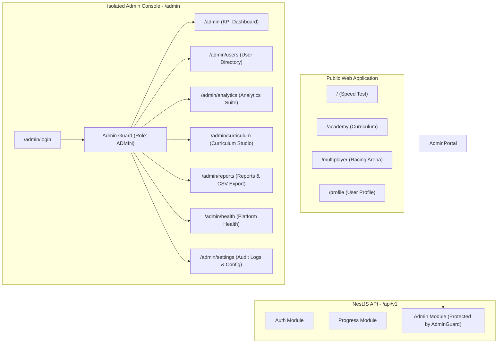

# Typing Typhon — Admin Panel Implementation Plan & Architecture Audit

**Document Version:** 1.0.0  
**Status:** Approved Implementation Blueprint  
**Base Route:** `/admin` (Isolated Protected Next.js Layout + NestJS RBAC Guards)  
**Date:** October 2026  

---

## 1. Executive Summary & Repository Audit

Typing Typhon is a high-performance touch typing platform. This implementation plan outlines the engineering architecture for a dedicated, production-grade **Administrative Control Panel** (`/admin`).

### 1.1 Existing Architecture Audit

| Dimension | Current Repository State | Admin Panel Integration Strategy |
| :--- | :--- | :--- |
| **Monorepo** | Turborepo with npm workspaces (`apps/web`, `apps/api`, `packages/contracts`) | Reused. Contracts package extended with admin DTOs and interfaces. |
| **Frontend** | Next.js 15 (App Router), React 19, TypeScript, Vanilla CSS design tokens | New isolated route tree under `/admin` with dedicated layout, sidebar, and navbar. |
| **Backend** | NestJS 10, TypeScript, Express, Cookie-Parser, Throttler | New `AdminModule` with `AdminController`, `AdminService`, and `AdminGuard`. |
| **Database** | PostgreSQL via Prisma ORM (`User`, `TypingSession`, `Certificate`) | Schema extended with `AuditLog` table and `status`/`isActive` fields on `User`. |
| **Authentication** | JWT stored in HttpOnly cookies (`access_token`, `refresh_token`), SHA256 hashed refresh tokens | Strict RBAC: only users with `role: 'ADMIN'` can access admin APIs and routes. |
| **Curriculum** | 6 stages, 25 systematic lessons in `@typingtyphon/contracts` | Admin Curriculum Studio for reviewing lesson thresholds, pass criteria, and progress. |
| **Resilience** | `PrismaService` development fallback when PostgreSQL container is offline | Built-in in-memory fallback for seed admin and demo data during local dev/testing. |

---

## 2. Capability Mapping

---

## 3. Phased Implementation Roadmap

### Phase 1: Audit & Planning (Complete)
- Inspect codebase, Prisma schema, and API routes.
- Produce core planning and specification documents.
- Establish baseline test suites.

### Phase 2: Contracts, Database Schema & Admin Auth
- Extend Prisma schema with `AuditLog` and user status.
- Add admin DTOs to `@typingtyphon/contracts`.
- Implement `AdminGuard` in NestJS backend.
- Build split-screen Admin Login page (`/admin/login`).

### Phase 3: Global Admin Layout & Navigation
- Build persistent collapsible left sidebar matching reference.
- Build top navigation bar with search, notification badge, and profile chip.
- Create responsive mobile drawer for administrative controls.

### Phase 4: Executive KPI Dashboard & Real API Integrations
- Implement `GET /api/v1/admin/dashboard` aggregation endpoints.
- Build 4 KPI cards (Total Users, Active Users, Tests Completed, Avg WPM).
- Build User Growth interactive chart and User Distribution donut chart.
- Implement Recent User Activity feed and Top Performing Lessons panel.
- Implement Platform Health monitor widget.

### Phase 5: User & Student Management
- Implement `GET /api/v1/admin/users` with server-side pagination, search, role, and status filtering.
- Implement User Detail drawer/modal.
- Implement user status update (`PATCH /api/v1/admin/users/:id/status`) with audit logging.
- Implement safe CSV export with formula injection sanitization.

### Phase 6: Analytics, Curriculum, Reports & Operations
- Analytics suite with tabbed interface (Overview, User Analytics, Performance, Retention, Geography).
- Curriculum management view showing stages, lessons, pass rates, and lesson editor modal.
- Reports generator with customizable date ranges and CSV downloads.
- System health diagnostic panel.
- Audit log viewer in Settings.

### Phase 7: Verification & Testing
- Vitest unit and integration test coverage.
- Full typecheck and production build.
- Browser automation verification of all views and workflows.
